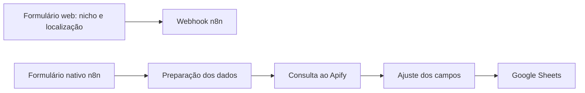
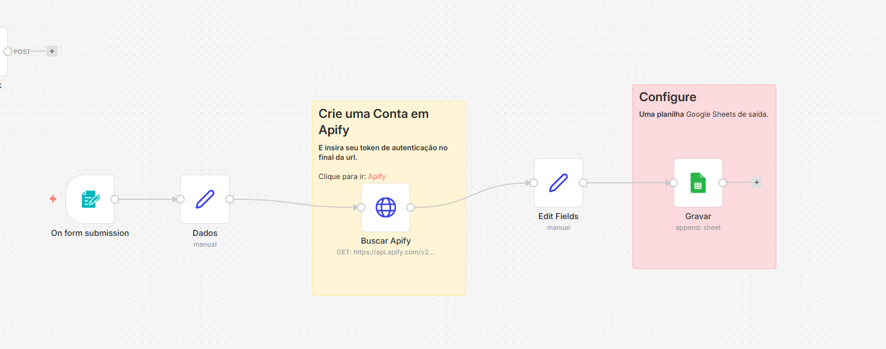

# CaptaLeads

Captação de leads com interface web e automação em n8n, conectando Apify e Google Sheets.

Desenvolvi o fluxo de automação completo e utilizei a solução pessoalmente e na empresa júnior. Este repositório contém a interface web e a documentação do caso; o export JSON do n8n ainda não foi recuperado.

## Problema

Apoiar a prospecção com uma entrada simples de nicho e localização e organizar os leads em uma planilha, reduzindo etapas manuais entre a solicitação e o registro dos dados.

## Funcionamento

O código da interface coleta `nicho` e `localizacao` e envia uma solicitação JSON por POST para um webhook do n8n. A captura fornecida pelo autor mostra uma entrada nativa de formulário, preparação de dados, consulta ao Apify, ajuste de campos e gravação no Google Sheets.

O diagrama separa a entrada comprovada no código da sequência visível na captura. A ligação do webhook a essa sequência depende da conferência do workflow completo; não é comprovada pelo print recortado.

## Minha contribuição

- Construção do fluxo completo de automação no n8n.
- Uso da solução em atividades pessoais e na empresa júnior.
- Interface web para solicitar buscas por nicho e localização, com integração via webhook.

## Tecnologias

HTML, CSS e JavaScript na interface; n8n na orquestração; Apify na consulta; Google Sheets como destino dos leads.

O fluxo documentado é uma automação de processos. Não há etapa de LLM identificada no código deste repositório ou na captura apresentada.

## Evidências e resultados

| Evidência | O que demonstra |
| --- | --- |
| [Código da interface](index.html) | Campos de busca e envio assíncrono para webhook. |
| Captura do n8n acima | Sequência visual de consulta ao Apify e gravação no Sheets. |
| Experiência do autor | Uso pessoal e na empresa júnior. |

Não há métricas históricas consolidadas de leads, conversão ou horas economizadas. A captura não comprova execução bem-sucedida nem disponibilidade atual. O funcionamento ponta a ponta não foi revalidado nesta revisão documental.

## Consultar a interface

Abra `index.html` em um navegador para visualizar a página. O botão de envio aponta para um webhook externo configurado no código e pode acionar uma automação real; visualizar a página não exige enviar o formulário.

Para reutilizar a solução, configure um ambiente próprio de n8n, a consulta ao Apify e as credenciais de uma planilha Google Sheets. Sem o export do workflow, este repositório não oferece uma instalação completa reproduzível.

## Próximos passos

- [ ] Recuperar e revisar o export JSON do fluxo, removendo credenciais e dados de terceiros.
- [ ] Conferir a conexão entre o formulário web e o workflow apresentado.
- [ ] Gravar uma execução controlada com dados fictícios e mostrar a saída na planilha.
- [ ] Registrar falhas, duplicidades e duração de execuções em um teste reproduzível.
- [ ] Medir tempo manual e automatizado antes de publicar estimativas de economia.

A captura foi fornecida pelo autor para documentar seu projeto. URLs administrativas do editor n8n não são usadas como demonstração pública.
