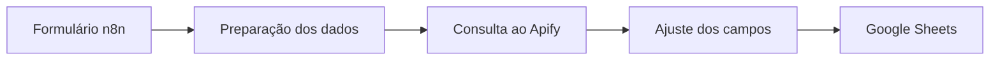

# CaptaLeads

Criei o CaptaLeads para facilitar a captação e a organização de leads. Montei o fluxo completo no n8n, conectando Apify e Google Sheets, e usei a solução tanto nas minhas atividades quanto na empresa júnior.

Neste repositório, mantenho a interface web e a documentação da automação. Ainda estou recuperando o export JSON do workflow.

## O que eu queria resolver

Queria solicitar buscas por nicho e localização e reunir os leads em uma planilha, sem precisar fazer manualmente cada etapa entre a busca e o registro dos dados.

## Como funciona

Na interface web, preencho nicho e localização. A página envia esses campos por POST para um webhook do n8n.

Na captura abaixo, meu fluxo usa o formulário nativo do n8n como entrada. Em seguida, preparo os dados, consulto o Apify, ajusto os campos e gravo os leads no Google Sheets.

Estou recuperando a versão completa do workflow para documentar também a conexão com o formulário web e disponibilizar um exemplo que possa ser importado.

## O que fiz

- Montei o fluxo completo da automação no n8n.
- Integrei a consulta ao Apify e a gravação dos leads no Google Sheets.
- Conectei a interface web a um webhook para enviar os critérios de busca.
- Usei a ferramenta na minha rotina e em atividades da empresa júnior.

## Tecnologias

HTML, CSS e JavaScript na interface, n8n na orquestração, Apify na consulta e Google Sheets para organizar os leads.

## Uso e resultados

Usei a solução em atividades reais de prospecção. Ainda não consolidei os números de leads gerados ou o tempo economizado, então não apresento estimativas de resultado.

A captura mostra a estrutura do fluxo. Ainda preciso conferir a configuração atual e registrar uma nova execução completa.

## Como visualizar

Abra `index.html` no navegador para conhecer a interface. O botão de busca envia dados para um webhook externo; para testar em outro ambiente, configure seu próprio endpoint.

Para reproduzir a automação, você também vai precisar de uma instância do n8n, acesso ao Apify e credenciais de uma planilha Google Sheets. Ainda não disponibilizei o export completo do workflow.

## O que quero melhorar

- [ ] Recuperar o export JSON e remover credenciais e dados de terceiros antes de compartilhá-lo.
- [ ] Conferir a integração entre o formulário web e o workflow.
- [ ] Gravar uma execução com dados fictícios e mostrar a planilha de saída.
- [ ] Melhorar o tratamento de falhas e duplicidades.
- [ ] Medir o tempo da tarefa manual e da automação.
